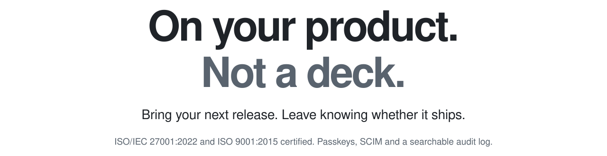
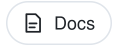

<!--
  Every image on this page is drawn by scripts/build.py in this repository, once for each GitHub theme.
  The product screenshot is KaDeep Studio Pro 4.0, from docs.kadeep.ai.
-->

<picture>
  <source media="(prefers-color-scheme: dark)" srcset="assets/dark/hero.svg">
  
</picture>

<b>KaDeep™ Studio Pro is the quality operation that knows when your product is ready to ship.</b> 
Release-readiness for web, mobile and desktop. 
The agent walks the live product, files what matters, and returns a ship decision.

<a href="https://studio.kadeep.ai/sample"><picture><source media="(prefers-color-scheme: dark)" srcset="assets/dark/btn-sample.svg"></picture></a><a
  href="https://studio.kadeep.ai"><picture><source media="(prefers-color-scheme: dark)" srcset="assets/dark/btn-launch.svg"></picture></a><a
  href="https://kadeep.ai/get-started"><picture><source media="(prefers-color-scheme: dark)" srcset="assets/dark/btn-walkthrough.svg"></picture></a>

 

<a href="https://kadeep.ai/studio"><picture>
  <source media="(prefers-color-scheme: dark)" srcset="assets/dark/board.svg">
  
</picture></a>

  

<picture>
  <source media="(prefers-color-scheme: dark)" srcset="assets/dark/every.svg">
  
</picture>

  

<picture>
  <source media="(prefers-color-scheme: dark)" srcset="assets/dark/hub.svg">
  
</picture>

  

<a href="https://github.com/kadeep-ai/kadeep-cli"><picture>
  <source media="(prefers-color-scheme: dark)" srcset="assets/dark/gate.svg">
  
</picture></a>

<a href="https://github.com/kadeep-ai/kadeep-cli"><picture><source media="(prefers-color-scheme: dark)" srcset="assets/dark/btn-repo.svg"></picture></a>

 

<picture>
  <source media="(prefers-color-scheme: dark)" srcset="assets/dark/close.svg">
  
</picture>

<a href="https://kadeep.ai/get-started"><picture><source media="(prefers-color-scheme: dark)" srcset="assets/dark/btn-book.svg"></picture></a><a
  href="https://studio.kadeep.ai"><picture><source media="(prefers-color-scheme: dark)" srcset="assets/dark/btn-open.svg"></picture></a>

 

<a href="https://kadeep.ai"><picture><source media="(prefers-color-scheme: dark)" srcset="assets/dark/chip-site.svg"></picture></a><a
  href="https://docs.kadeep.ai"><picture><source media="(prefers-color-scheme: dark)" srcset="assets/dark/chip-docs.svg"></picture></a><a
  href="https://www.linkedin.com/company/kadeep-ai"><picture><source media="(prefers-color-scheme: dark)" srcset="assets/dark/chip-linkedin.svg"></picture></a><a
  href="https://www.youtube.com/@kadeeptechnologies"><picture><source media="(prefers-color-scheme: dark)" srcset="assets/dark/chip-youtube.svg"></picture></a>

KaDeep AI builds KaDeep Studio in Mumbai. Want to build it with us? Say hello on <a href="https://www.linkedin.com/company/kadeep-ai">LinkedIn</a>.

